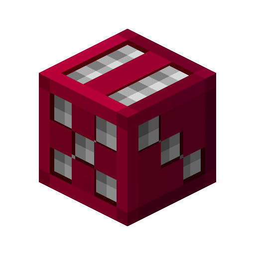

# Archfiend

A client-side Fabric mod for **Minecraft 26.2** that turns Hypixel SkyBlock RNG drops into a 3D chest reveal.

When a drop like `CRAZY RARE DROP!` or `PET DROP!` appears in chat, the drop message is held back and a 3D treasure chest drops in. It bursts open, revealing the item you actually got, and the chat message is released the moment it is revealed, so chat can't spoil the roll.

## Features

- **Two styles**
  - `chest`: a 3D treasure chest drops into the GUI with physics (bounces, wobble, squash and stretch), rattles, then bursts open on a hyperbolic-tangent curve with an exaggerated overshoot. A spinning, glowing question mark floats out, cycling through random rarity colours before slowly settling on the drop's real rarity colour and turning into the item.
  - `world_chest`: the same chest as a real 3D object in the world — it drops from the sky onto where the mob died (or in front of you), lands with client-side physics, rattles, bursts open, and the glowing question mark and item appear in the world above it. Falls back to `chest` when there is no valid spot in front of you.
- **Real SkyBlock items:** icons and models come from the [NotEnoughUpdates item repo](https://github.com/NotEnoughUpdates/NotEnoughUpdates-REPO): textured heads, dyed leather, enchant glint, and Hypixel's own models when their resource pack is loaded.
- **Queue:** drops that arrive mid-sequence wait their turn (up to 8).
- **HUD hider:** the hotbar, health, scoreboard, chat and your hand are hidden while a sequence plays (toggle in settings).
- **Drop confirmation:** every announced drop is matched against what actually arrives, in your inventory (by SkyBlock item id) or a sack. The reveal shows where it landed, for example "✔ Inventory" or "→ Combat Sack".
- **Persistent drop history and stats:** every drop is saved to `config/archfiend/drops.json` with its tier, Magic Find and destination.
- Sounds, reveal banners, a screen flash for top-tier drops, and a skip keybind.

## How it works

1. Chat messages are matched against trigger prefixes (`RARE DROP!`, `VERY RARE DROP!`, `CRAZY RARE DROP!`, `PET DROP!`, `EXTREMELY RARE DROP!`, `INSANE DROP!`, `PRAY TO RNGESUS DROP!`, `RNGESUS INCARNATE`). Only the start of a message is checked, so player chat can't trigger it.
2. The item name and its rarity colour are read from the message.
3. Drops at or above `minTier` are queued, and their message is held back until the reveal.
4. The item is looked up in the NEU repo for custom models and textures, and the chest sequence animates the reveal.

The NEU repo is downloaded on first launch (about 22 MB) to `config/archfiend/neu-repo.zip`. On later launches the cached copy loads instantly, and the mod checks GitHub for a newer commit. If GitHub is unreachable, the cache keeps working.

## Settings

Open the settings menu with `/archfiend config`, the **Open Archfiend Settings** keybind, or the config button in [Mod Menu](https://modrinth.com/mod/modmenu) (optional). Every option has a tooltip, and **Preview** plays a test sequence.

## Commands

| Command | Description |
|---|---|
| `/archfiend` | Status |
| `/archfiend config` | Open the settings menu |
| `/archfiend stats` | Lifetime drop counts per tier and most common items |
| `/archfiend history [n]` | Your last *n* drops with Magic Find and where they landed |
| `/archfiend log` | Recent item arrivals and how each drop was matched (troubleshooting) |
| `/archfiend test [tier] [item]` | Preview, e.g. `/archfiend test crazy_rare Warden Heart` |
| `/archfiend style <chest|world_chest>` | Switch style |
| `/archfiend mintier <tier>` | Lowest tier that triggers a sequence (default `crazy_rare`) |
| `/archfiend spin <ticks>` / `scale <x>` / `volume <x>` | Tuning |
| `/archfiend toggle` / `chatdelay` / `skip` | Enable/disable, hold back the drop message, skip the current sequence |
| `/archfiend repo [update]` | NEU repo status, force update |
| `/archfiend reload` | Reload the config |

Tiers: `rare`, `very_rare`, `crazy_rare`, `pet`, `extremely_rare`, `insane`, `pray_to_rngesus`, `rngesus_incarnate`.

**Skip RNG Drop Sequence** and **Open Archfiend Settings** keybinds are under *Controls → Archfiend* (unbound by default).

## Configuration

`config/archfiend.json` is created on first launch. Besides everything in the settings menu, it holds:

- `triggers`: chat prefixes and the tier each one maps to. Edit these if Hypixel changes its wording.
- `repo`: enable/disable the NEU repo, auto-update, or point it at a fork (`repository`, `branch`).

## Building

Requires **JDK 25**.

```sh
git clone --recursive https://github.com/dreadpiratejoelius/archfiend.git
cd archfiend
./gradlew build          # Windows: gradlew.bat build
```

The jar is written to `build/libs/archfiend-<version>.jar`. Put it in your `mods` folder alongside [Fabric API](https://modrinth.com/mod/fabric-api) (Fabric Loader 0.19.5+).

Other tasks:

```sh
./gradlew runClient      # launch a dev client with the mod
./gradlew test           # run unit tests
```

`--recursive` also clones the NEU repo submodule into `neu-repo/`. It is optional: the build doesn't need it, and the mod downloads the latest NEU data at runtime. If you already cloned without it, run `git submodule update --init`.

## Inspiration

- Inspired by [Scatha-Pro](https://github.com/NamelessJu/Scatha-Pro) and [SkyOcean](https://github.com/meowdding/SkyOcean)

## Credits

- [NotEnoughUpdates-REPO](https://github.com/NotEnoughUpdates/NotEnoughUpdates-REPO) for item data and models
- [SkyMaxx](https://modrinth.com/mod/skymaxx) (MIT) for showing how to render 3D models in the 26.x GUI
- "[Minecraft Chest](https://sketchfab.com/3d-models/minecraft-chest-83c5b03288e9416fbe65616e45de2918)" by Blender3D, licensed under [CC BY 4.0](http://creativecommons.org/licenses/by/4.0/); the texture is downscaled at load time

The icon is the Archfiend Dice item from Hypixel SkyBlock, taken from the [Hypixel SkyBlock Wiki](https://hypixelskyblock.minecraft.wiki/w/Archfiend_Dice).

Not affiliated with Hypixel or Mojang.
